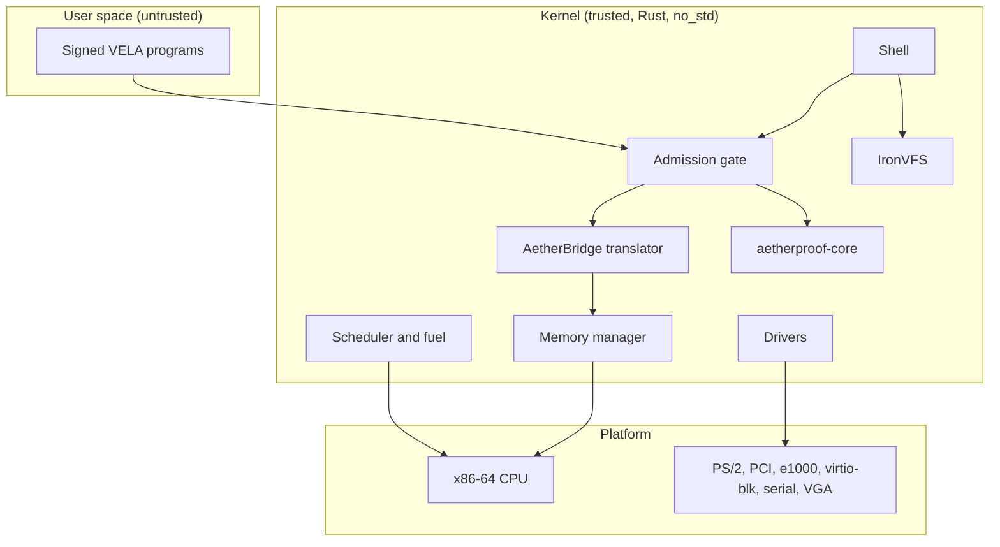
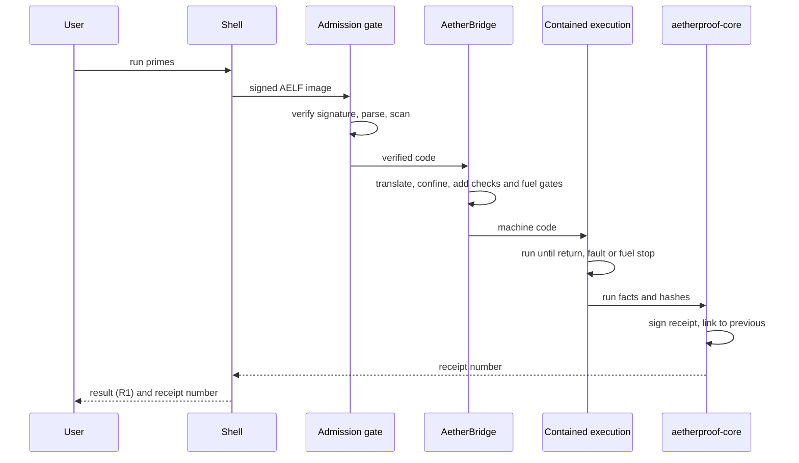
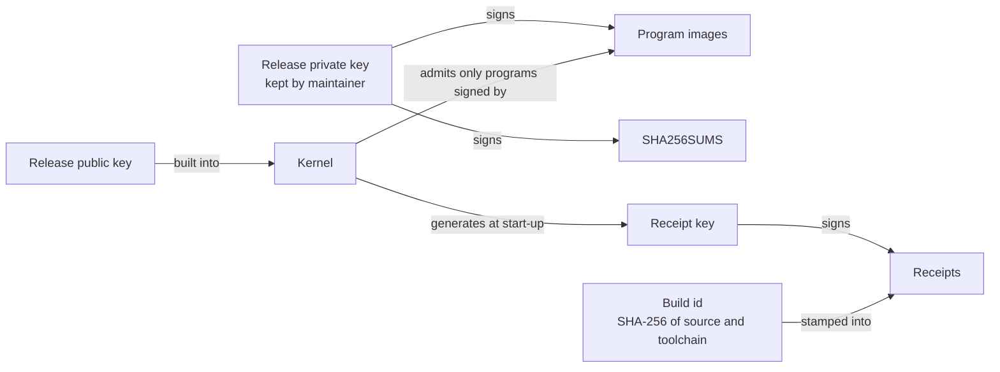
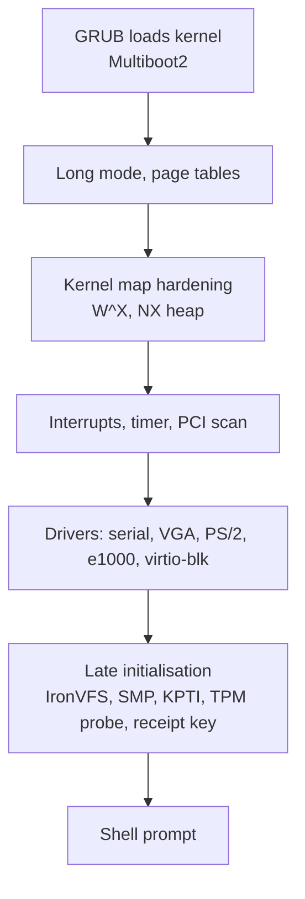

# AetherOS architecture

This document describes the structure of AetherOS 0.92.0: its layers, the path a program
takes, the trust model and the boot sequence. Detailed design notes and status history
are in `ARCHITECTURE.html`.

## 1. Layers

| Component | Responsibility | Source |
|---|---|---|
| Admission gate | Ed25519 signature check, AELF parsing, instruction scan | `kernel/src/exec.rs` |
| AetherBridge | VELA to x86-64 translation, sandbox confinement, runtime checks, fuel gates | `kernel/src/bridge.rs` |
| aetherproof-core | Receipt format, hash chain and verification, shared with the host verifier | `aetherproof-core/` |
| IronVFS | In-memory file system with per-block integrity hashes | `kernel/src/fs/ironvfs.rs` |
| Memory manager | Page tables, write-xor-execute, kernel page isolation, sandbox arena | `kernel/src/mem/`, `kernel/src/arch/vela1/kmap.rs` |
| Shell | Commands and manual pages | `kernel/src/shell/` |

## 2. Program path

## 3. Trust model

- The kernel trusts one admission key, fixed at build time. Release builds refuse to be
  built with the published development key.
- Receipt keys are generated at each start-up from hardware randomness. A key sealed in
  the TPM, which would identify the machine, is planned.
- Receipts name the kernel by its build id, so a verifier can rebuild the kernel from
  source and compare.

## 4. Boot sequence

Development builds run the self-test suite (about 700 checks) between steps E and F.
Release builds go directly to the prompt.

## 5. Receipt format (v2, 280 bytes)

| Bytes | Field |
|---|---|
| 0-3 | Magic `APR2` |
| 4 | Version (2) |
| 5 | Flags (bit 0: key derived from measured TPM PCRs, never set in 0.92; bit 1: weak entropy) |
| 6-7 | Reserved (0) |
| 8-15 | Sequence number |
| 16-19 | Process id |
| 20-23 | Syscall count |
| 24-31 | Timestamp |
| 32-39 | Program length |
| 40-47 | Control-flow hash |
| 48-55 | Memory hash |
| 56-87 | Program SHA-256 |
| 88-119 | AetherBridge output SHA-256 |
| 120-151 | Kernel build id |
| 152-183 | Previous receipt SHA-256 |
| 184-215 | Signer public key |
| 216-279 | Ed25519 signature over a fixed domain string and bytes 0-215 |
