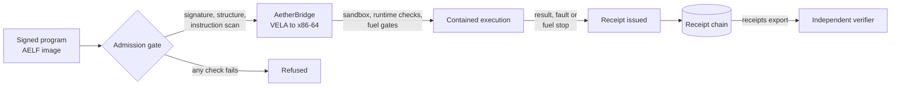
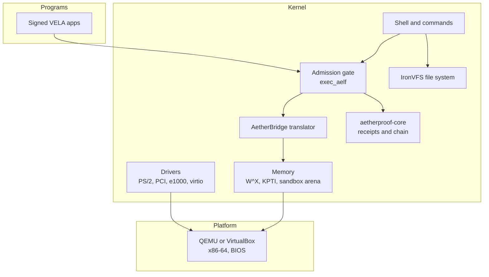
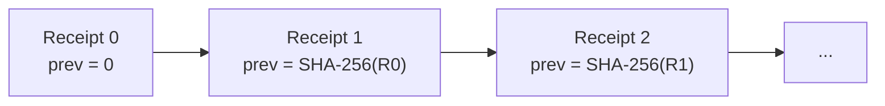

# AetherOS

AetherOS is an operating system written from scratch for verifiable execution. Only
signed programs run, every program runs through a checked translator inside a sandbox,
and every finished run produces a signed, hash-chained receipt that anyone can verify
on another computer.

Created by Pulkit Srivastava.

**Status:** research preview, version 0.92.0. The first public test release, for
VirtualBox, is scheduled for 22 November 2026.

## Why AetherOS

On conventional systems the record of what a computer did is kept by the same machine,
and the same administrators, that could change it. AetherOS makes the record
independently checkable: a receipt names the exact program, the exact machine code it
was translated into, and the exact kernel build that ran it, and the receipts form a
chain in which a removed, reordered or altered entry is detected.

AetherOS is designed as a small trusted component that runs next to a conventional
system, for work whose record must hold up when it is disputed: automated and AI-driven
decisions, approval and payment steps, and audit trails.

## How a program runs



## System architecture



## Receipts



Each receipt (280 bytes) records the program's SHA-256, the SHA-256 of the machine code
AetherBridge produced, the kernel build id, a control-flow hash, process facts, the hash
of the previous receipt, and an Ed25519 signature. The verifier checks every signature,
the sequence and the links.

## Getting started

Download the release, verify it, and boot it in VirtualBox with BIOS firmware. Full
steps: [Documentation/MANUAL.md](Documentation/MANUAL.md#3-installing-and-starting).

```sh
openssl pkeyutl -verify -pubin -inkey release.pub.pem -rawin -in SHA256SUMS -sigfile SHA256SUMS.sig
sha256sum -c SHA256SUMS
```

At the `aether>` prompt:

```
help              list commands
apps              list the signed programs in this build
run primes        verify, translate, run and receipt a program
receipts          show whether the receipt chain is intact
about trust       show the keys this system trusts
```

## Source code

This repository holds the public documentation. The source code and the signed VirtualBox
test image are published with the test release on 22 November 2026.

## Documentation

| Document | Contents |
|---|---|
| [Documentation/MANUAL.md](Documentation/MANUAL.md) | User and developer manual |
| [Documentation/man/](Documentation/man/README.md) | Manual page for every shell command |
| [Documentation/ARCHITECTURE.md](Documentation/ARCHITECTURE.md) | Architecture, trust model and data flow |
| [RELEASE_NOTES.md](RELEASE_NOTES.md) | Release notes |
| [SECURITY.md](SECURITY.md) | Reporting security issues |

## Project status

AetherOS runs in QEMU and VirtualBox with BIOS firmware. Files are held in memory, the
receipt key is generated at each start-up, and there is no graphical interface yet. The
full list of limits is in the manual, chapter 14, and open findings are tracked in
the source tree (`tests/findings/FINDINGS.md`).

## Licence

Documentation in this repository: MIT (see [LICENSE](LICENSE)). Source code, when published:
kernel under the Mozilla Public License 2.0; instruction set, tools and tests under the Apache
License 2.0.
